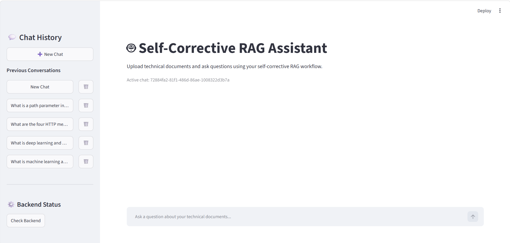
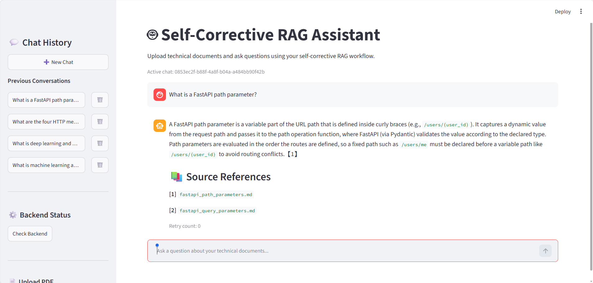
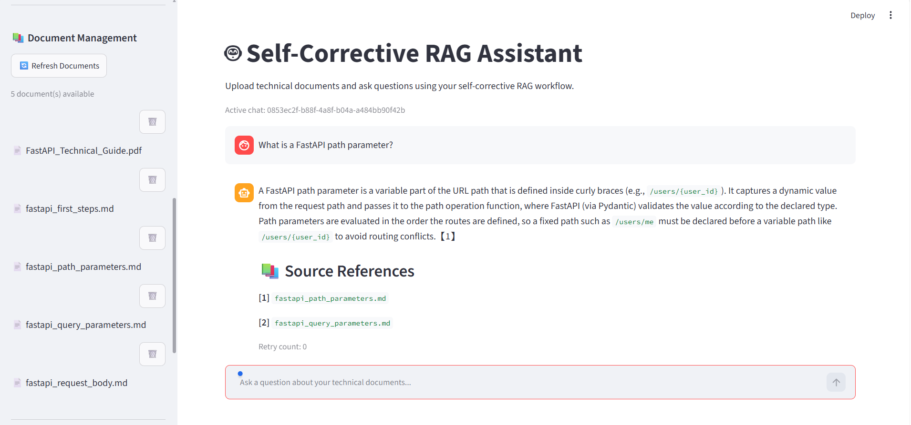
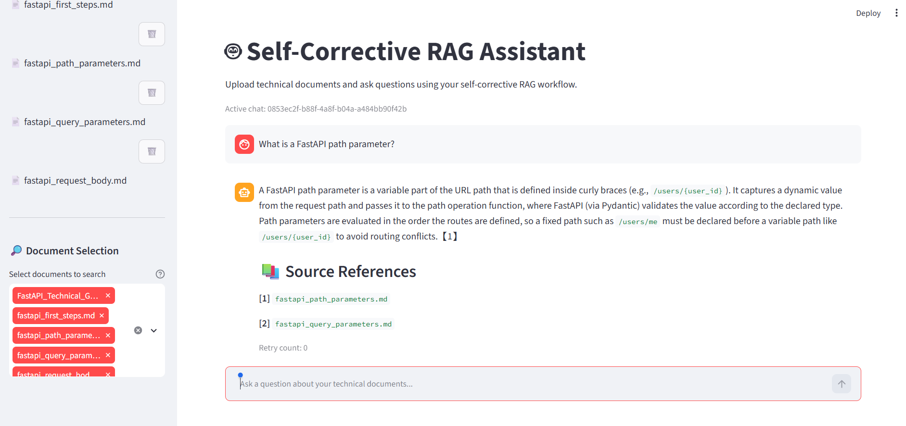

# 🧠 Self-Corrective RAG Assistant

An end-to-end **Retrieval-Augmented Generation (RAG)** application that answers questions from technical documents using a self-corrective workflow built with **LangGraph, LangChain, FastAPI, and ChromaDB**.

Unlike a basic RAG pipeline, this application analyzes queries, retrieves relevant document chunks, evaluates their relevance, and rewrites queries when retrieval results are insufficient.

It provides a Streamlit interface for document uploads, document-level filtering, and persistent conversation history.

## ✨ Key Features

- **Self-Corrective RAG Workflow:** Uses LangGraph to orchestrate query analysis, retrieval, relevance grading, generation, and query rewriting.
- **Semantic Search:** Uses Sentence Transformers embeddings and ChromaDB for vector-based document retrieval.
- **Document Relevance Grading:** Evaluates retrieved documents before generating answers.
- **Query Rewriting:** Rewrites queries when relevant information cannot be retrieved.
- **Source Citations:** Provides document-based citations with source filenames and page information.
- **No-Answer Handling:** Provides fallback responses when sufficient relevant information is unavailable.
- **Document Management:** Upload, list, filter, and delete PDF documents.
- **Conversation Memory:** Maintains recent conversation context for follow-up questions.
- **Chat History:** Stores conversations using SQLite, with support for creating, opening, and deleting chat sessions.
- **Streamlit Frontend:** Interactive interface for document-based question answering.
- **FastAPI Backend:** REST APIs for document ingestion, retrieval, and chat management.
- **Docker Support:** Separate backend and frontend containers orchestrated using Docker Compose.

## 📸 Application Screenshots

### 1. Main Application Interface


### 2. RAG Response with Source Citations


### 3. Uploaded Documents


### 4. Document Selection and Filtering


## 🏗️ System Architecture

The application follows a conditional self-corrective RAG workflow.

```text
             User Question
                   |
                   v
          +------------------+
          |  Query Analysis  |
          +------------------+
                   |
                   v
          +------------------+
          |    Retrieval     |
          |     ChromaDB     |
          +------------------+
                   |
                   v
          +------------------+
          | Relevance Grading|
          +------------------+
                   |
                   v
          +------------------+
          | Relevant Context?|
          +------------------+
              /         \
            Yes          No
             |            |
             v            v
        Generation    Query Rewrite
             |            |
             |            +----> Retrieval
             v
       Grounded Answer
             |
             v
       Source Citations
             |
             v
           Output
```

## 🛠️ Technology Stack

| Component | Technologies |
|---|---|
| Programming Language | Python |
| RAG Framework | LangChain |
| Workflow Orchestration | LangGraph |
| Backend | FastAPI |
| Frontend | Streamlit |
| Vector Database | ChromaDB |
| Embeddings | Sentence Transformers |
| LLM Integration | LangChain Groq |
| Conversation Storage | SQLite |
| Containerization | Docker, Docker Compose |
| Version Control | Git, GitHub |

## 📂 Project Structure

```text
self-corrective-rag-assistant/
│
├── app/
│   ├── __init__.py
│   ├── main.py
│   ├── graph.py
│   ├── workflow.py
│   ├── ingestion.py
│   ├── retrieval.py
│   ├── retrieval_node.py
│   ├── query_analysis.py
│   ├── grading.py
│   ├── generation.py
│   ├── rewrite.py
│   ├── conditions.py
│   ├── llm.py
│   └── chat_store.py
│
├── data/
│   └── documents/
│
├── streamlit_app.py
├── requirements.txt
├── requirements-frontend.txt
├── Dockerfile
├── Dockerfile.streamlit
├── docker-compose.yml
├── .dockerignore
├── .gitignore
└── README.md
```

## ⚙️ Installation and Setup

### 1. Clone the Repository

```bash
git clone https://github.com/abhishekmathad50/self-corrective-rag-assistant.git

cd self-corrective-rag-assistant
```

### 2. Create a Virtual Environment

```bash
python -m venv .venv
```

Activate it:

**Windows PowerShell**

```powershell
.venv\Scripts\Activate.ps1
```

**Linux / macOS**

```bash
source .venv/bin/activate
```

### 3. Install Dependencies

```bash
pip install -r requirements.txt
```

### 4. Configure Environment Variables

Create a `.env` file in the project root:

```env
GROQ_API_KEY=your_groq_api_key
```

Replace the placeholder with your own API key.

Never commit your actual `.env` file or expose API keys publicly.

### 5. Start the Backend

```bash
python -m uvicorn app.main:app --reload --port 8000
```

Backend API:

```text
http://127.0.0.1:8000
```

API documentation:

```text
http://127.0.0.1:8000/docs
```

### 6. Start the Frontend

Open another terminal, activate the virtual environment, and run:

```bash
python -m streamlit run streamlit_app.py
```

Frontend:

```text
http://localhost:8501
```

## 🐳 Running with Docker

The project supports containerized deployment using Docker Compose.

### Prerequisites

- Docker Desktop
- Docker Compose
- Groq API key

### 1. Configure Environment Variables

Create the `.env` file in the project root:

```env
GROQ_API_KEY=your_groq_api_key
```

### 2. Build and Start Containers

```bash
docker compose up --build -d
```

### 3. Access the Application

| Service | URL |
|---|---|
| Streamlit Frontend | http://localhost:8501 |
| FastAPI Backend | http://localhost:8000 |
| API Documentation | http://localhost:8000/docs |

### 4. Stop the Containers

```bash
docker compose down
```

## 🔄 Application Workflow

1. **Query Analysis:** Analyzes the user's question and prepares it for retrieval.
2. **Document Retrieval:** Searches the ChromaDB vector database for semantically relevant document chunks.
3. **Relevance Grading:** Evaluates retrieved documents to determine whether they are useful for answering the question.
4. **Conditional Routing:** Proceeds to generation when relevant context is available or triggers query rewriting when retrieval is insufficient.
5. **Query Rewriting:** Reformulates the question and retries retrieval within a configured retry limit.
6. **Answer Generation:** Generates a response using the retrieved context.
7. **Source Attribution:** Returns supporting document references with the generated answer.

## 💡 Application Capabilities

- Ask questions about uploaded technical documentation.
- Upload and manage PDF documents.
- Filter retrieval using selected documents.
- Receive answers with source citations.
- Ask follow-up questions using recent conversation context.
- Maintain multiple chat sessions.
- Access previous conversations.
- Handle irrelevant questions with fallback responses.

## 🔮 Future Improvements

- Retrieval and answer-quality evaluation using RAGAS.
- Advanced reranking strategies.
- Improved observability and workflow tracing.
- Cloud deployment and scalable infrastructure.
- Automated testing and CI/CD integration.

## 👨‍💻 Author

**Abhishek Mathad**

Python | AI/ML | Generative AI | RAG | LangGraph

- GitHub: https://github.com/abhishekmathad50
- LinkedIn: https://www.linkedin.com/in/abhishek-mathad-b20184364/

---